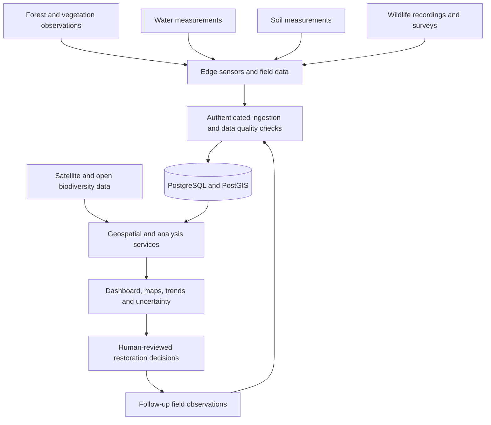

# 🌍 EarthPulse

### Open-source engineering for ecological restoration

**Measure → Understand → Act → Verify**

> We want to build technology that helps nature recover—not technology that merely reports its destruction.

**EarthPulse** is a student-led, open-source engineering and research mission to develop an interconnected environmental monitoring and decision-support platform. We aim to combine **embedded systems, C++, backend engineering, AI/ML, geospatial data, and ecological field research** to help communities and restoration organizations understand environmental change and evaluate restoration work.

**Timeline:** 2026–2030 (four-year roadmap)  
**Stage:** Planning / first prototype  
**Looking for:** Student contributors, ecology mentors, electronics enthusiasts, developers, researchers, and community partners

> **Important:** EarthPulse is an early-stage proposal, not an existing deployed environmental network. Our milestones are goals, not claims of completed work or proven ecological benefit.

---

## 🌱 Why EarthPulse?

Many ecosystems face habitat loss, pollution, soil degradation, water stress, and declining biodiversity. Software alone cannot solve these problems, and collecting data is **not** the same as restoration. However, well-designed tools can help field teams answer practical questions:

- What has changed at a restoration site?
- Are the measurements reliable enough to guide decisions?
- Are native plants surviving and habitat conditions improving?
- Do we see meaningful differences between restored and comparable reference areas?
- Which measurements would help local conservation groups most?

**Our goal is to produce useful evidence, not an arbitrary “nature health score.”** We want to build alongside ecologists, local communities, and restoration practitioners.

## 🎯 Mission and principles

**Mission:** Build an affordable, reproducible environmental intelligence system that connects field measurements, ecological observations, and public geospatial data to support restoration decisions.

Our principles:

1. **Ecology first:** Start with a real question from a field partner, then select technology.
2. **Evidence over hype:** Validate instruments, document uncertainty, and avoid unsupported claims.
3. **Open by design:** Publish code, hardware designs, protocols, and non-sensitive datasets when permitted.
4. **Low-cost and repairable:** Prefer maintainable hardware and power-efficient software.
5. **Privacy and wildlife safety:** Protect sensitive locations, community information, and field access details.
6. **Humans make decisions:** Models provide evidence; ecologists and communities decide on interventions.
7. **Build small, test outdoors, improve:** One reliable node beats a simulated network of 1,000.

## 🧩 The interconnected system



### Long-term modules

| Module | Possible measurements | Key caveat |
|---|---|---|
| Forest & vegetation | Native plant survival, habitat structure, vegetation trends | Green cover alone does not demonstrate recovery |
| Water | Temperature, turbidity, pH, dissolved oxygen where validated | Low-cost sensors require calibration and maintenance |
| Soil | Moisture, erosion observations, periodic soil tests | Cheap moisture probes are not lab-grade soil instruments |
| Wildlife | Acoustic recordings, expert-reviewed species observations | Detection probability and seasonal change matter |
| Geospatial | Satellite imagery, land cover, restoration plot mapping | Remote sensing cannot replace field verification |

## 🛠 Technology stack

| Layer | Planned technology | Purpose |
|---|---|---|
| Embedded | **C++**, ESP32 | Sensor drivers, sampling, buffering, efficient firmware |
| Electronics / ENTC | Sensor interfaces, power management, communications | Field-ready measurement hardware |
| Backend | **Python, FastAPI** | Device APIs, ingestion, validation, analytical services |
| Database | **PostgreSQL + PostGIS** | Time-series measurements, sites and spatial queries |
| Frontend | **React** | Dashboard, graphs and site maps |
| Messaging, later | **MQTT**, possibly LoRa | Multi-node telemetry and intermittent connections |
| AI / ML, later | Python, PyTorch, classical statistics | Detection and analysis after baselines exist |
| Data / GIS | QGIS, satellite and public biodiversity datasets | Landscape-level context |
| Infrastructure | Docker, tests, CI/CD | Reproducible development and deployment |

We will **not** introduce every tool on day one. The first prototype uses one ESP32, one authenticated API, one database, and one dashboard.

## 🚀 First working prototype: EarthPulse Node V1

**Goal:** Build and validate a low-cost environmental station at one authorized site.

### V1 measurements

- Air temperature
- Relative humidity
- Raw soil moisture probe reading (calibrated and labeled correctly when possible)
- Device uptime, connectivity and data quality
- Manual site observations and photographs with permission

### Tentative hardware budget (India)

| Item | Planning allowance |
|---|---:|
| ESP32 board | ₹400–700 |
| BME280 temperature/humidity sensor | ₹250–650 |
| Capacitive soil moisture probe | ₹150–400 |
| Breadboard, wiring, connectors | ₹200–400 |
| Outdoor enclosure and fittings | ₹400–1,000 |
| Safe regulated power source | ₹500–1,200 |
| Spares and miscellaneous | ₹500–1,000 |
| **Total** | **₹2,400–5,350** |

These are **rough budgets, not live vendor quotes**. Start with bench testing; never expose unprotected breadboards to rain. Obtain site permission before installation.

### Example telemetry schema

```json
{
  "device_id": "earthpulse-node-001",
  "timestamp": "2026-12-10T09:30:00Z",
  "measurements": {
    "air_temperature_c": 27.4,
    "relative_humidity_pct": 64.2,
    "soil_moisture_raw": 1840
  },
  "metadata": {
    "firmware_version": "0.1.0",
    "calibration_version": "soil-v1",
    "quality_flags": []
  }
}
```

*Example values only; not field results.*

### Initial API (proposed)

```http
POST /api/v1/telemetry
GET  /api/v1/devices
GET  /api/v1/devices/{id}/readings
GET  /api/v1/sites/{id}/summary
GET  /api/v1/sites/{id}/observations
POST /api/v1/observations
```

## 🗺 Four-year roadmap (2026–2030)

| Phase | Focus | Deliverable |
|---|---|---|
| **Year 1 — Foundation** | C++ firmware, ESP32, sensor validation, FastAPI, PostgreSQL, React | One field-tested node + dashboard + baseline protocol |
| **Year 2 — Ecological intelligence** | Field surveys, water module, geospatial analysis, wildlife acoustics, evaluated ML | Multi-domain dataset + baseline comparisons |
| **Year 3 — Distributed field network** | 5–10 nodes *if feasible*, offline sync, network reliability, controlled study design | Repeatable deployment + system reliability report |
| **Year 4 — Scientific validation** | Collaborate with ecologists, evaluate usefulness and environmental outcomes | Open platform + reproducible field report / research output |

**No milestone is automatic.** Hardware deployments, research, and ecological claims depend on funding, field access, expertise, and evidence.

## 📆 First 12 weeks

- [ ] **Weeks 1–2:** Find an accessible site and field advisor; obtain permission; formulate one research question.
- [ ] **Weeks 3–4:** Assemble ESP32 + BME280 + soil probe; write C++ firmware; calibrate against references.
- [ ] **Weeks 5–6:** Build authenticated FastAPI telemetry ingestion; store and validate data in PostgreSQL.
- [ ] **Weeks 7–8:** Create React charts, device health view, missing-data indicators, and site observation forms.
- [ ] **Weeks 9–10:** Run a controlled, safe field test; monitor uptime, failures, power and measurement drift.
- [ ] **Weeks 11–12:** Document results and limitations; publish reproducible code and a short technical report.

### Definition of done for V1

- [ ] A device records real sensor measurements with timestamps and units.
- [ ] A backend accepts authenticated data and handles malformed, duplicate or delayed readings.
- [ ] The dashboard shows measurements, missing data and device status.
- [ ] Calibration methods, reference comparisons and limitations are documented.
- [ ] Site authorization, data handling and maintenance responsibilities are recorded.
- [ ] Another student can reproduce a bench prototype from our instructions.

## 🔬 Research and field validation

**Working question:** *Can low-cost distributed sensing and standardized field observations provide reliable, useful evidence for small-scale ecological restoration?*

Potential research tracks:

1. **Sensor quality:** Compare against reference instruments; report bias, mean absolute error, drift and missing-data rates.
2. **Reliability:** Test network outages, timestamp correctness, weather resistance, power use and maintenance cost.
3. **Ecological indicators:** Record native plant survival and habitat observations with consistent protocols.
4. **AI evaluation:** Compare statistical baselines with ML; report false alerts, precision/recall and uncertainty.
5. **Restoration outcomes:** Where possible, compare restored plots with appropriate reference or control areas across seasons.

**Scientific boundary:** Changes in sensor readings alone do not prove ecological restoration. We will not claim causality without suitable study design and evidence.

## 📁 Proposed repository structure

```text
earthpulse/
├── README.md
├── LICENSE
├── CONTRIBUTING.md
├── CODE_OF_CONDUCT.md
├── firmware/              # ESP32/C++ firmware
├── hardware/              # Schematics, BOM, enclosure designs
├── backend/               # FastAPI and database migrations
├── dashboard/             # React application
├── analytics/             # Statistics, notebooks, future ML
├── field-protocols/       # Sampling, calibration, site safety
├── research/              # Questions, experiments, reports
├── docs/                  # Architecture and setup guides
└── .github/               # Issue templates and CI workflows
```

*This is the target layout; files and modules may not exist yet.*

## 🤝 Join the mission

You do **not** need to know everything to contribute. We especially welcome students who want to learn seriously through real work.

| Team | Example contributions | Beginner-friendly first task |
|---|---|---|
| Embedded C++ / ENTC | Drivers, calibration, power, field enclosures | Read a BME280 sensor and log time-stamped values |
| Backend | APIs, auth, validation, schema, testing | Build one telemetry endpoint with tests |
| Frontend | Charts, maps, accessibility, UX | Design a device-status dashboard mockup |
| AI/ML & data | Data quality, statistics, geospatial analysis | Plot readings and flag missing data without ML |
| Ecology & research | Site protocols, indicators, surveys | Draft an observation sheet with mentor review |
| Documentation & outreach | Setup guides, community contacts, demos | Explain the project and document reproducible setup |

### How to contribute (while the repository is being set up)

1. Read this README and choose a team or research question.
2. Share what you already know and what you want to learn.
3. Propose one small, testable task with an expected output.
4. Once the repository exists, open an issue before large changes and submit a focused pull request.
5. Include test evidence, setup instructions, and limitations.

**We value reliability, learning, respectful collaboration, and scientific integrity more than flashy demos.**

### Introduce yourself

Copy this into your first team discussion:

```text
Name / preferred handle:
College / year (optional):
Areas I'm interested in:
Skills I already have:
Skills I want to learn:
Hours I can realistically contribute each week:
One small task I want to own:
```

## 🧭 What we need before field deployment

- A consenting site owner / responsible authority.
- An ecological research partner or mentor to help define useful indicators.
- A sensor calibration and maintenance plan.
- Basic electrical, weather and enclosure safety measures.
- A data governance plan, particularly for private land and sensitive wildlife locations.
- A field protocol that distinguishes observed facts from predictions and interpretations.

## 📊 How we measure project success

**Engineering:** Data completeness, calibration error, uptime, maintainability, total cost.  
**Research:** Reproducible methods, documented uncertainty, valid comparisons, evidence quality.  
**Real-world usefulness:** Whether practitioners can make better-informed decisions and whether follow-up measurements are feasible.  
**Environmental impact:** Any restoration outcome must be assessed independently of the software itself and reported with appropriate caveats.

## 🔗 Starting resources

- [Society for Ecological Restoration](https://www.ser.org/) — restoration principles and standards
- [Copernicus Data Space](https://dataspace.copernicus.eu/) — Earth observation data
- [ISRO Bhuvan](https://bhuvan.nrsc.gov.in/) — geospatial resources for India
- [GBIF](https://www.gbif.org/) — biodiversity occurrence data
- [India Biodiversity Portal](https://indiabiodiversity.org/) — community biodiversity observations
- [Open Acoustic Devices](https://www.openacousticdevices.info/) — wildlife sound monitoring tools

## 📣 An invitation

We are at the beginning. No giant team, no claims of breakthrough results, no promise that AI will fix the planet.

We want to start with **one real site, one reliable prototype, one careful experiment, and a group of people willing to build together for years**.

If you are a developer, electronics student, ecology enthusiast, designer, researcher, or someone who simply cares deeply about the natural world, there is room to contribute.

> **EarthPulse: Engineer for recovery. Build for the living world.**

---

**Project status:** Proposed / recruiting initial collaborators.  
**Repository:** Add GitHub URL once created.  
**Contact:** Add team email or discussion link once established.  
**License:** To be selected by the founding contributors; do not assume the project is licensed until a LICENSE file is added.
